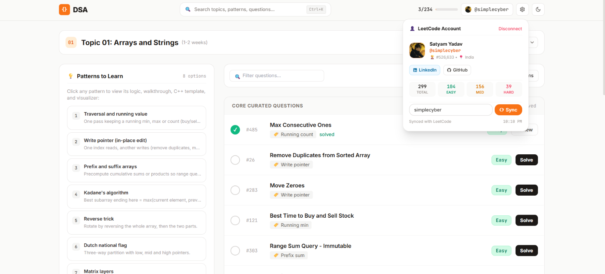
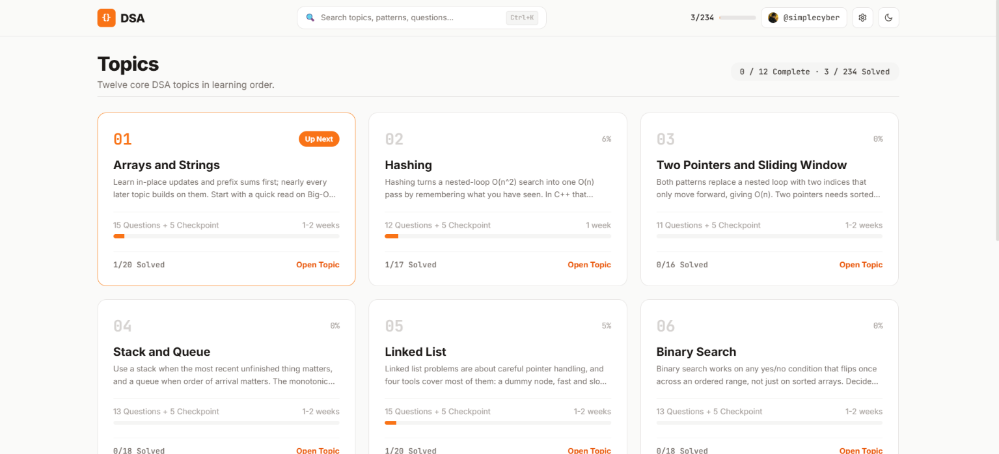

# DSA Patterns ⚡

> **Stop watching 500 tutorial videos.** Master Data Structures & Algorithms by learning the underlying **patterns**, intuition, and templates.

[](https://opensource.org/licenses/MIT)
[](https://developer.mozilla.org/en-US/docs/Web/JavaScript)
[-emerald)](#quickstart)
[](https://leetcode.com)

---

## 📸 Screenshots

### 🗺️ Topic Overview & Roadmap Grid
Track your progress across 12 milestone topics with live solved statistics and percentage completion.



### ⚡ Topic Detail & Pattern Breakdown
Interactive pattern cards, step-by-step logic, C++ templates, and curated problem checkpoints with live LeetCode verification.



---

## 💡 The Philosophy

Most engineers preparing for coding interviews get stuck in **tutorial hell**:
- ❌ Watching 50-hour playlist courses explaining the same loop variations.
- ❌ Memorizing individual LeetCode problem solutions one by one.
- ❌ Forgetting the solution the moment a problem statement is tweaked.

**DSA Patterns** takes a different approach:
Every interview problem is just an instance of a fundamental algorithmic pattern (Two Pointers, Sliding Window, Monotonic Stack, Multi-source BFS, Interval Scheduling, State-machine DP, etc.). 

Once you internalize the **pattern invariant**, the **step-by-step intuition**, and the **idiomatic C++ template**, solving 20 problems from the same category feels identical.

---

## ✨ Features

- **🎯 12 Curated Milestone Topics**: Carefully structured roadmap spanning from foundational array manipulations to advanced 2D & Tree Dynamic Programming.
- **🧠 Pattern-First Learning Cards**:
  - **Core Intuition ("Why it works")**: Conceptual explanation in plain English.
  - **Step-by-Step Walkthrough**: Detailed trace through a concrete example.
  - **Common Pitfalls & Traps**: Edge cases that trigger `Wrong Answer` or `Time Limit Exceeded`.
  - **Clean C++ Reference Code**: Copy-pasteable boilerplate with one click.
- **📊 Interactive Visualizers**: Real-time algorithm simulations right inside the browser to build strong spatial intuition.
- **⚡ Live LeetCode Sync**:
  - Connects to your real LeetCode profile via API.
  - Fetches accepted submissions in real time.
  - Strict verification: only marks questions as `✓ solved` when officially accepted (no false positives from failed test cases).
- **🎨 Sleek, Distraction-Free UI**:
  - Fast, modular design built with Tailwind CSS.
  - Native **Light & Dark mode** with smooth theme persistence.
  - In-place profile & settings popover.
  - Filter by difficulty (`Easy`, `Medium`, `Hard`) and toggle `Unsolved Only`.
- **🚀 Zero Build Step / 100% Offline Capable**:
  - No `node_modules`, no Webpack, no Vite.
  - Double-click `dsa.html` in your browser and start studying immediately.

---

## 🗺️ The 12-Topic Roadmap

| # | Topic | Key Patterns | Curated Problems |
|---|---|---|:---:|
| **01** | **Arrays & Strings** | Running memory, Read/Write pointer, Prefix sums, Kadane's, Dutch National Flag, In-place matrix rotation | 20 |
| **02** | **Hashing** | Two-pass map, Frequency signatures, HashSet existence, Prefix mod buckets | 20 |
| **03** | **Two Pointers & Sliding Window** | Opposite-direction scan, Same-direction fast/slow, Fixed & Dynamic windows, Exact-K via `atMost(K)` | 20 |
| **04** | **Stacks & Queues** | Matching pairs, Postfix evaluation, Monotonic decreasing/increasing stacks, Min-Stack, Sliding window deque | 20 |
| **05** | **Linked Lists** | Dummy head sentinel, Fast & Slow pointers, In-place reversal, Merge lists, LRU Cache doubly linked list | 20 |
| **06** | **Binary Search** | Classic search, Lower/Upper bound, Rotated sorted search, Binary search on answer space, Peak finding | 20 |
| **07** | **Recursion & Backtracking** | Subsets / Branching, Permutations with swap/mark, Combination Sum, Palindrome cuts, Grid DFS, N-Queens | 20 |
| **08** | **Trees & BST** | Pre/In/Post traversals, Subtree combination, Root-to-leaf paths, Lowest Common Ancestor, BST validation | 20 |
| **09** | **Heap & Priority Queue** | Top-K elements, K-way merge, Running median with dual heaps, Frequency greedy heaps | 20 |
| **10** | **Greedy & Intervals** | Interval scheduling, Earliest deadline first, Jump Game reachability, Gas station circuit, Dual-pass greedy | 20 |
| **11** | **Graphs** | Connected components, Grid DFS (Islands), Multi-source BFS (Rotting Oranges), Topological sort, DSU & Kruskal's | 20 |
| **12** | **Dynamic Programming** | 1D Robber, Longest Increasing Subsequence with tails binary search, 2D Grid paths, State-machine DP, Tree DP | 20 |

---

## 🚀 Quickstart

No dependencies or servers are required.

### Option 1: Direct File Open
1. Download or clone this repository:
   ```bash
   git clone https://github.com/your-username/dsa-patterns.git
   cd dsa-patterns
   ```
2. Double-click `dsa.html` to open it in Chrome, Firefox, Edge, or Safari.

### Option 2: Local HTTP Server (Optional)
If you prefer running through a local server:
```bash
# Python 3
python -m http.server 8000

# or Node.js npx
npx serve .
```
Then visit `http://localhost:8000/dsa.html`.

---

## 🔗 Connecting Your LeetCode Account

1. Click **Connect LC** (or your username badge) in the top navbar.
2. Enter your LeetCode username (e.g., `simplecyber`).
3. Click **Sync Solves**.
4. The application contacts the public LeetCode API to fetch:
   - Your avatar, ranking, and total accepted problem counts.
   - Your recent accepted submissions (`status: "Accepted"`).
5. All matching questions in the roadmap are automatically verified and marked as `solved`.

---

## 📂 Project Architecture

```text
dsa-final/
├── dsa.html                  # Main application entry point
├── css/
│   └── styles.css            # Custom CSS utilities & syntax styling
└── js/
    ├── app.js                # Hash router & application bootstrap
    ├── state.js              # Reactive state, LocalStorage, LeetCode sync
    ├── components/
    │   ├── nav.js            # Top navigation, avatar chip, theme switch
    │   ├── palette.js        # Command palette (Ctrl/Cmd + K)
    │   ├── toast.js          # Non-blocking notification toasts
    │   └── visualizer-ui.js  # Interactive algorithm visualizer harness
    ├── data/
    │   ├── topics.js         # Curated questions, checkpoint challenges, topics
    │   ├── patterns-data.js  # Core logic, walkthroughs, C++ templates (Y & DET)
    │   └── visualizers.js    # Simulation engines for patterns
    └── pages/
        ├── topics.js         # Topic grid / dashboard overview
        ├── topic-detail.js   # Problem table, pattern drawer, collapsible header
        └── settings.js       # Minimal in-place popover settings
```

---

## ⌨️ Shortcuts

| Shortcut | Action |
|---|---|
| `Ctrl + K` / `Cmd + K` | Open quick command palette / search problems |
| `Escape` | Close active pattern modal or settings popover |

---

## 🤝 Contributing

Contributions are welcome! If you'd like to contribute:
1. Add new pattern walkthroughs or cleaner C++ implementations in `js/data/patterns-data.js`.
2. Add new interactive algorithm visualizations in `js/data/visualizers.js`.
3. Submit an issue or open a pull request.

---

## 📄 License

This project is open-source under the [MIT License](LICENSE).
